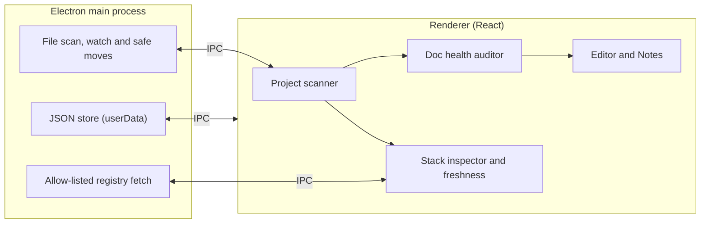

<div align="center">


# Litho

**A local-first Markdown studio, with DocAtlas built in for keeping every project's documentation and tech stack healthy.**

[](LICENSE)


</div>

---

Litho is a desktop app for people who keep a lot of Markdown: project docs, notes, agent and skill specs. It has two halves that work as one loop:

- **DocAtlas** scans a folder of projects (for example `C:\Prj`) and tells you, per project, which docs are missing, which are stale, duplicated or orphaned, and whether the tech stack still runs today.
- **The editor** is where you fix what DocAtlas finds: write the missing README, retire a stale doc, or jot down a note that belongs to no project at all.

Everything stays on your disk. Litho reads and writes plain `.md` files in place; there is no account, database or sync service.

## Contents

- [Features](#features)
- [Getting started](#getting-started)
- [Keyboard shortcuts](#keyboard-shortcuts)
- [Privacy and network access](#privacy-and-network-access)
- [How it works](#how-it-works)
- [Project structure](#project-structure)
- [Development](#development)
- [Roadmap](#roadmap)
- [Contributing](#contributing)
- [License](#license)

## Features

### DocAtlas: documentation and stack health

| | What you get |
| --- | --- |
| **Portfolio overview** | Every project under one or more root folders, including apps nested up to three levels deep (folders your `.gitignore` excludes are skipped). Results are remembered, so the page opens instantly and refreshes quietly when it's more than 6 hours old. |
| **Doc health** | Each doc is classified as canonical, healthy, module doc, stale, duplicate, deprecated, orphan or agent-system. Each project gets an A–D grade and a list of missing docs. |
| **Fix-it actions** | Archive, deprecate (pointing at its replacement), restore, adopt an orphan into the README, sync drifted docs, or create a missing doc from a template. Moves rewrite relative links and never overwrite a file. |
| **Stack freshness** | Expo SDK, React Native, Next.js, Electron and other frameworks are checked against the live npm and PyPI registries. Expo package alignment and Node/Python end-of-life dates are checked too. Each project is rated *Current*, *Aging* or *At risk*, with an upgrade radar and a stack-versions matrix across all projects. |
| **DocPassport** | A per-document health badge in the editor, with the same actions one click away. |

### Editor and notes

| | What you get |
| --- | --- |
| **Live Markdown editing** | Rich in-place editing, a split preview and a reader mode, with raw source one click away. It has a slash-command menu, a floating formatting toolbar, interactive checklists, Mermaid diagrams, math, and `[[wiki links]]` with backlinks. |
| **Clean files** | Frontmatter is preserved, and plain files stay plain: editing a file without YAML frontmatter never adds any. |
| **Notes** | `Ctrl+N` creates a note from anywhere in the app, in `Documents\DocAtlas Notes` or a folder you choose in Settings. A note with an automatic name takes its heading as its file name once you move on. |
| **Open any file** | `Ctrl+O` opens a `.md` file from anywhere. Files inside a known project open in that project; others open in Notes and are saved in place. "Save as…" (`Ctrl+Shift+S`) writes a copy wherever you like. |
| **Live disk sync** | External changes to the open folder are picked up automatically. Your own autosaves don't trigger rescans. |
| **Workspace views** | A database hub (table, kanban and gallery views driven by frontmatter), a task list that collects every checkbox across all docs, a knowledge graph, and a command palette. |

### AI (optional)

AI is opt-in. It supports **local Ollama** (`http://localhost:11434`, fully offline) or your own **Google Gemini** or **OpenAI** key. It summarises documents, suggests categories and tags, chats across the open project's docs, and has a testbed for agent and skill specs (with export to Antigravity skill JSON).

## Getting started

**Requirements:** Node.js 20 or newer and npm. Windows is the tested platform. Electron is cross-platform, but macOS and Linux haven't been verified yet.

```bash
git clone https://github.com/MacMbizo/litho.git
cd litho
npm install
npm run build
npm start
```

On first launch, choose your projects folder (for example `C:\Prj`) on the DocAtlas page, or press `Ctrl+N` to start writing straight away.

To open a file directly:

```bash
npm start -- "C:\path\to\notes.md"
```

If Litho is already running, the file opens in the existing window.

> **Browser preview:** `npm run dev` serves the UI at <http://localhost:5173> with a built-in sample vault. Portfolio scanning, Notes and file dialogs need the desktop app.

## Keyboard shortcuts

| Shortcut | Action |
| --- | --- |
| `Ctrl+K` | Command palette: search docs, jump to views, run actions |
| `Ctrl+N` | New note |
| `Ctrl+O` | Open a Markdown file |
| `Ctrl+S` | Save |
| `Ctrl+Shift+S` | Save as… |
| `Ctrl+\` | Show or hide the sidebar |
| `/` (in the editor) | Slash commands |
| `[[` (in the editor) | Link to another doc |

## Privacy and network access

- **Your files never leave your machine** unless you turn on a cloud AI provider.
- **Network requests** are limited, in the Electron main process, to the npm registry, PyPI and jsDelivr's Expo `bundledNativeModules.json`. They're used only for the stack-freshness check, and answers are cached for 24 hours.
- **App data** (portfolio snapshot, Notes settings) is stored as JSON under the app's user-data folder.
- **API keys:** if you add a Gemini or OpenAI key, it's stored in the app's local storage on this machine. It isn't encrypted, so don't use a shared Windows account if that matters to you.

## How it works



- **Main process** (`electron/`): scanning, nested-app discovery, file watching, never-overwrite moves, dialogs, the JSON store and the allow-listed network fetch. The renderer runs with `contextIsolation` and talks to it only through the typed bridge in `electron/preload.ts`.
- **Services** (`src/services/`): pure TypeScript for auditing, remediation, stack inspection, freshness scoring and the Notes workspace, unit-tested without a browser.

## Project structure

```text
electron/            Electron main process, preload bridge, stack file discovery
src/
  components/
    project/         DocAtlas portfolio, project dashboard, DocPassport, freshness panel
    editor/          Markdown editor, toolbars, Mermaid and math blocks, backlinks
    layout/          Sidebar, top bar, tabs, command palette, context menu
    database/        Table, kanban and gallery views
    ai/              AI settings, summaries, project chat, agent testbed
  services/          Auditor, remediation, stack inspector, freshness, notes, markdown
  types/             Shared types
tests/               node:test suites (bundled with esbuild)
docs/superpowers/    Design specs and implementation plans
```

## Development

| Task | Command |
| --- | --- |
| Run the desktop app | `npm run build && npm start` |
| Browser dev server (sample vault) | `npm run dev` |
| Unit tests | `npm test` |
| Type-check | `npx tsc --noEmit -p .` |
| Re-render app icons from `assets/brand/*.svg` | `npx electron scripts/render-icons.cjs` |

Doc-health and stack heuristics are calibrated against real projects, not only fixtures. If you change a rule, run it against a real folder of projects before trusting the result.

## Roadmap

- [ ] Windows installer with "Open with Litho" for `.md` files
- [ ] Weekly background check with a desktop notification when a new Expo SDK ships or a runtime reaches end-of-life
- [ ] "Save upgrade plan" to every at-risk project at once
- [ ] Opt-in tracking of all dependencies, not just the main frameworks
- [ ] CI workflow running tests and type-checks on every push

## Contributing

Issues and pull requests are welcome. Before opening a PR:

1. Run `npm test` and `npx tsc --noEmit -p .`.
2. Check UI changes in the desktop app, not just the browser preview.
3. Keep plain Markdown files plain, and never overwrite user files: both are tested invariants.

## License

[MIT](LICENSE) © 2026 MacMbizo
